# ICAS Website

**A responsive, accessible website and demo student portal for ICAS
(International Center for Applied Science), built with React, Vite and
Express.**


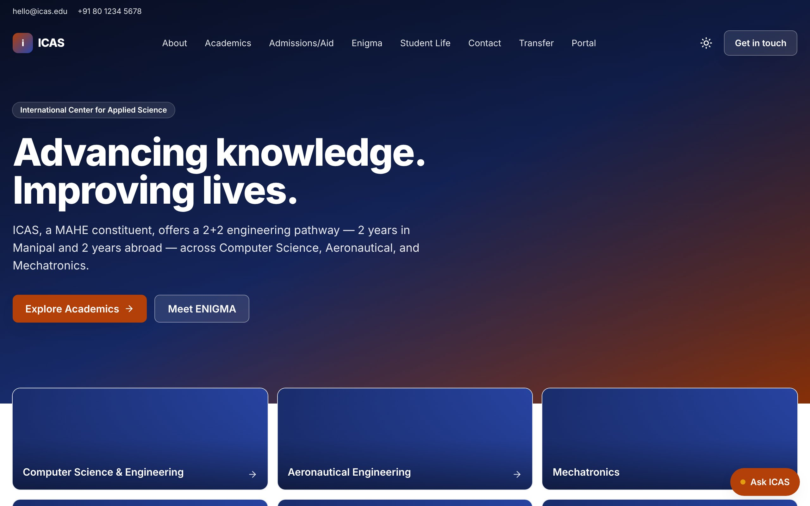

## Contents

- [Overview](#overview)
- [Screenshots](#screenshots)
- [Features](#features)
- [Tech stack](#tech-stack)
- [Architecture](#architecture)
- [Project structure](#project-structure)
- [Getting started](#getting-started)
- [Configuration](#configuration)
- [Running the app](#running-the-app)
- [Usage guide](#usage-guide)
- [Scripts](#scripts)
- [API reference](#api-reference)
- [Design system and accessibility](#design-system-and-accessibility)
- [Testing](#testing)
- [Linting and formatting](#linting-and-formatting)
- [Deployment](#deployment)
- [Troubleshooting and FAQ](#troubleshooting-and-faq)
- [Known limitations](#known-limitations)
- [Roadmap](#roadmap)
- [Contributing](#contributing)
- [License](#license)

## Overview

ICAS is a MAHE constituent that offers a **2+2 engineering pathway**: students
spend two years in Manipal and then transfer to a partner university abroad
for the last two years. Prospective students and their families need one place
to understand the programs, the transfer options, admissions and financial
aid, and what campus life looks like. Current students need a simple place to
see deadlines and hand in work.

This project provides both:

- a **public website** with 15 content pages (academics, admissions, transfer
  partners, research, student life, events, news and more), and
- a **demo student portal** with a dashboard, course pages and assignment
  submission.

It is a single-page React app served by a small Express server. All content
is static sample data stored in the repository, so it runs without a database
or any external service.

**Who it's for:** the ICAS team as a starting point for its web presence, and
developers who want a clean, tested React + Express reference project.

## Screenshots

All screenshots were taken from the production build (`pnpm build && pnpm
start`) with the repository's demo data. The capture environment blocked
third-party image hosts, so remote photos appear as the site's built-in
fallbacks (branded gradients). With network access the real photos load in
their place.

| Home (light)                                                 | Home (dark)                                                      |
| ------------------------------------------------------------ | ---------------------------------------------------------------- |
|  | 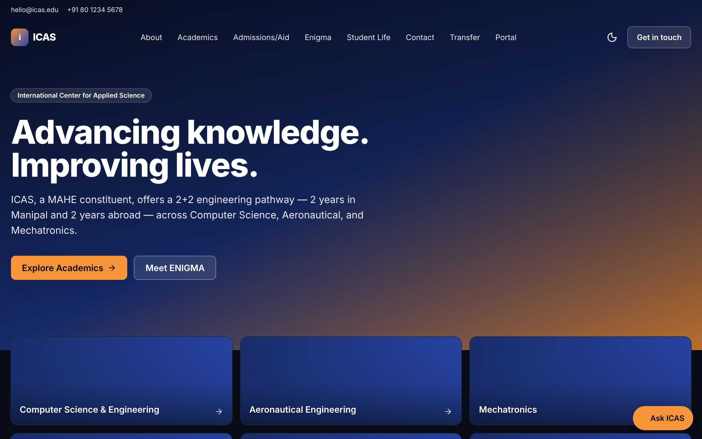 |

| Academic calendar                                                                         | Portal dashboard                                                           |
| ----------------------------------------------------------------------------------------- | -------------------------------------------------------------------------- |
| 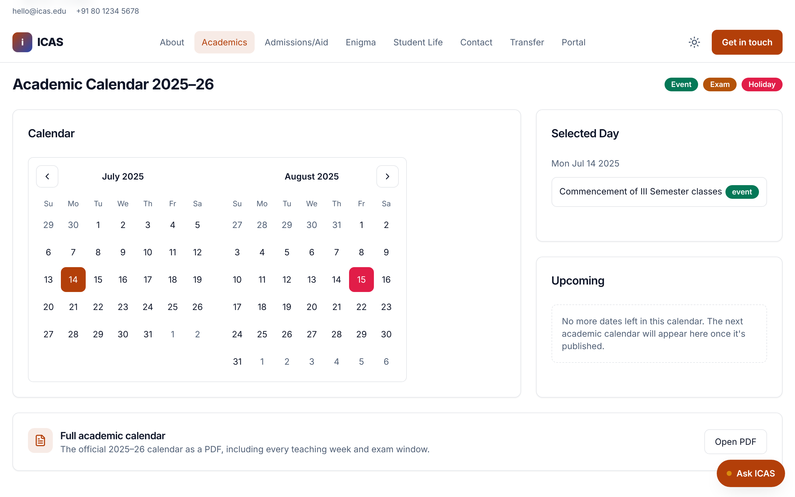 | 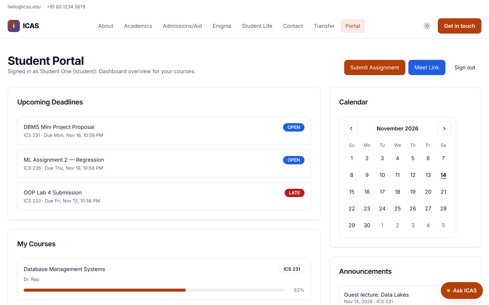 |

| Course page after submitting                                                          | Portal login                                                           |
| ------------------------------------------------------------------------------------- | ---------------------------------------------------------------------- |
| 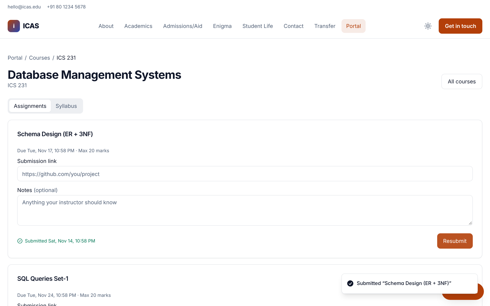 | 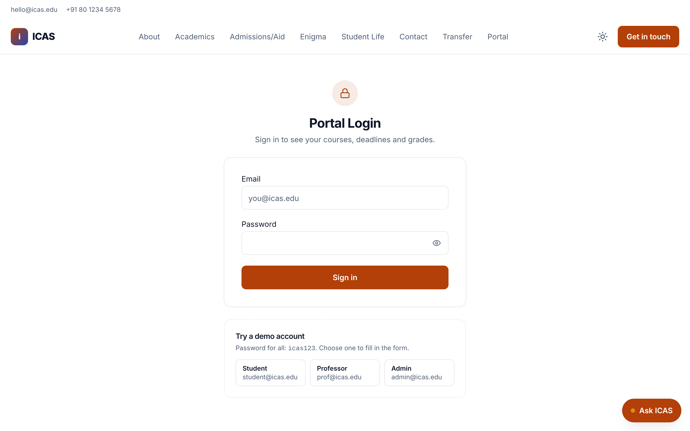 |

| Phone: home                                               | Phone: menu                                                 | Phone: form validation                                                                      | Phone: portal (dark)                                                                 |
| --------------------------------------------------------- | ----------------------------------------------------------- | ------------------------------------------------------------------------------------------- | ------------------------------------------------------------------------------------ |
| 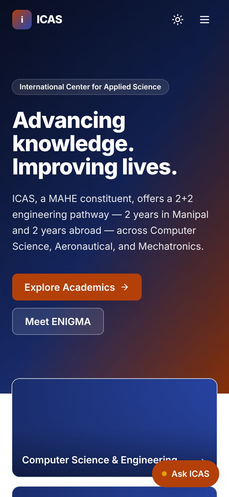 | 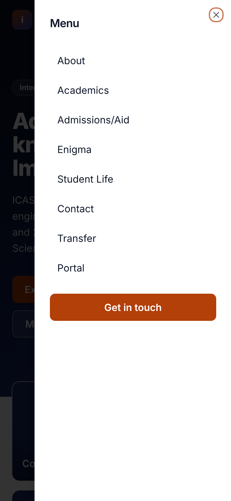 | 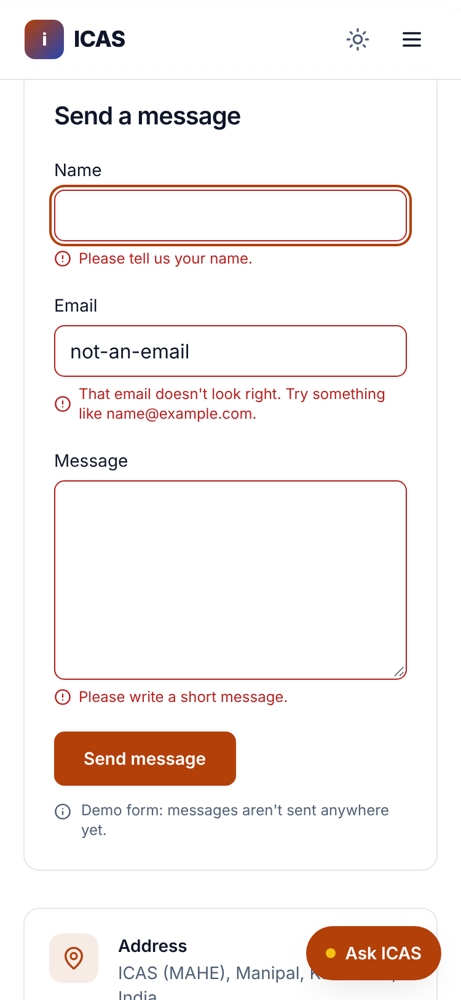 | 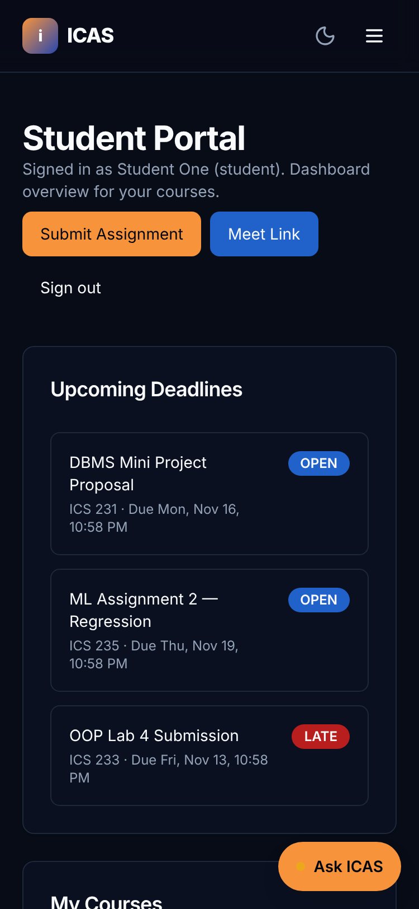 |

<details>
<summary>404 page</summary>

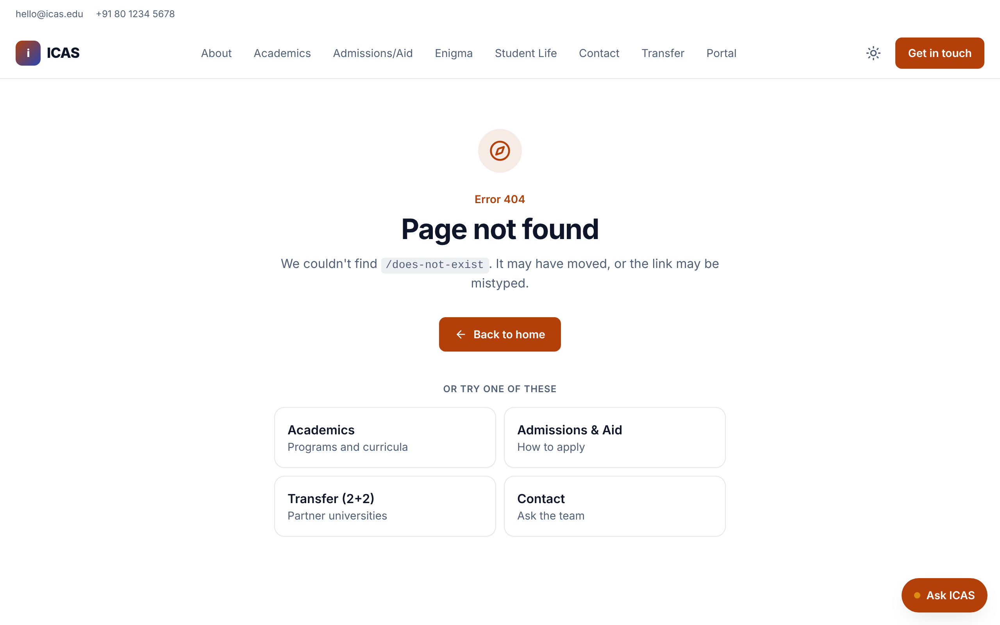

</details>

## Features

**Public site**

- 15 content pages: About, Academics, Admissions & Aid, Transfer (2+2),
  Research, Student Life, ENIGMA student club, News, Events, Faculty,
  Financial Aid, Medical Aid, Impact, Contact, and the home page.
- **Academics:** program cards, a semester-by-semester curriculum accordion
  for each branch, an interactive academic calendar colour-coded by event,
  exam and holiday, and a link to the full PDF calendar.
- **Transfer:** a Leaflet world map of 112 partner universities (loaded only
  on this page), a year-by-year chart of where alumni transferred (aggregate
  counts only), and the full partner list grouped by country.
- **Student Life:** a sample student feed, a weekly class timetable, and an
  alumni directory with sample profiles.
- **Contact and newsletter forms** with inline validation messages and a
  success state. They are not connected to a backend yet (the UI says so).
- **"Ask ICAS" navigator:** a floating panel where you type a question
  ("financial aid", "upcoming events") and get links to matching pages. It is
  keyword matching, not a chatbot.

**Demo student portal** (`/portal`)

- Sign-in with three demo accounts and one-click "fill in" buttons.
- Dashboard with upcoming deadlines, courses and progress, a calendar,
  announcements and a grades snapshot.
- Course pages with assignments and syllabus tabs. Submissions (link and
  notes) are saved in the browser's `localStorage` and survive reloads.
- Protected routes: visiting a portal page while signed out sends you to the
  login page and back again afterwards. The `?next=` parameter only accepts
  same-site paths, so it can't be used as an open redirect.

**Experience and quality**

- Light and dark themes that follow the system setting, with a toggle in the
  header. The choice is remembered and applied before first paint, so there's
  no flash of the wrong theme.
- Responsive from 320 px phones to wide desktops, with a slide-out menu below
  1024 px. Verified with no horizontal scrolling at 375, 768 and 1280 px.
- Accessible: skip link, labelled controls, visible focus rings, keyboard
  support in menus and dialogs, live regions for status messages, reduced
  motion support, and WCAG AA colour contrast. An automated axe-core scan of
  every public route reports no WCAG 2 A/AA violations in either theme.
- Resilient: remote images fall back to branded placeholders, each route is
  lazy-loaded behind a loading indicator and an error boundary, and there is a
  helpful 404 page.
- Per-page `<title>`, meta description, Open Graph and Twitter tags, SVG
  favicon, web manifest and `robots.txt`.

> [!IMPORTANT]
> The portal login exists **for demonstration only**. Demo accounts are
> stored in client-side code (`client/data/sample.ts`) and the session lives
> in `localStorage`, so it provides no real security. Connect a real auth
> backend before handling any real student data.

## Tech stack

| Area            | Tools                                                                                                              |
| --------------- | ------------------------------------------------------------------------------------------------------------------ |
| UI framework    | React 18, React Router 6, TypeScript (strict)                                                                      |
| Build tool      | Vite 7 with the SWC React plugin                                                                                   |
| Styling         | Tailwind CSS 3, `@tailwindcss/typography`, `tailwindcss-animate`, CSS variables for theming                        |
| Components      | shadcn/ui-style primitives on Radix UI (dialog, sheet, tabs, accordion, label, progress, avatar)                   |
| UI extras       | Leaflet (map), Recharts (charts), Embla (carousel), react-day-picker 9 (calendar), Sonner (toasts), Lucide (icons) |
| Server          | Express 5 (API and static hosting), `cors`, `dotenv`                                                               |
| Serverless      | `serverless-http` wrapper for Netlify Functions                                                                    |
| Testing         | Vitest 4, Testing Library, jsdom                                                                                   |
| Code quality    | ESLint 9 (typescript-eslint, react-hooks), Prettier 3                                                              |
| Package manager | pnpm 10 (pinned through `packageManager`)                                                                          |

## Architecture

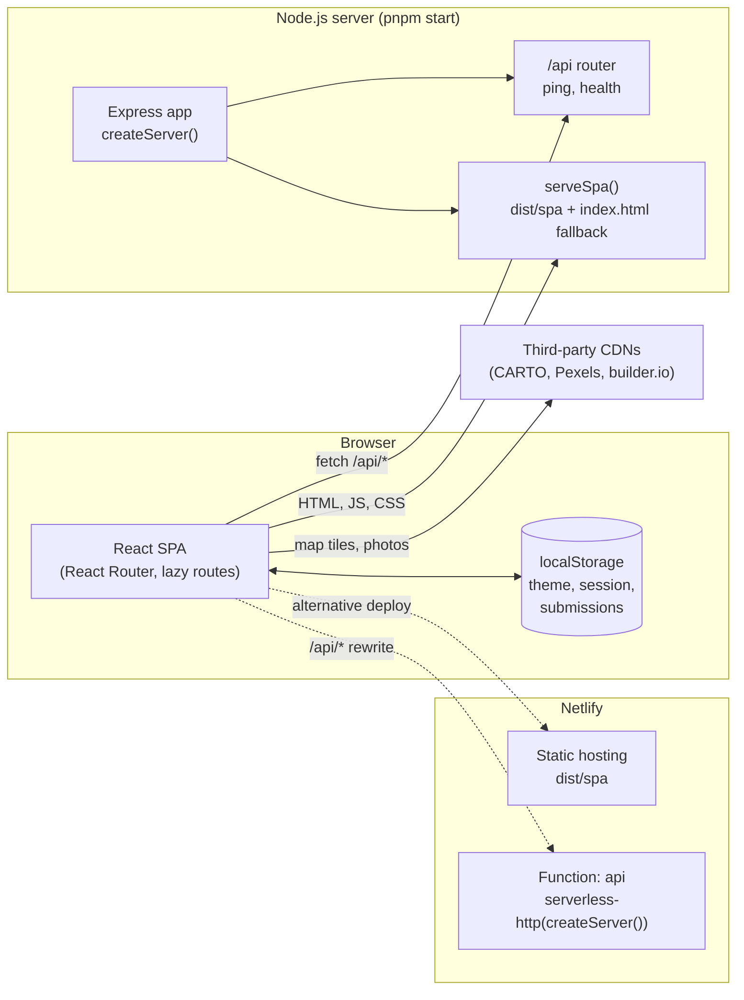

**How the pieces fit:**

- **One Express app, three hosts.** `server/index.ts` exports
  `createServer()`, which builds the Express app with an `/api` router. The
  same function is used by:
  - the **Vite dev server** (mounted as middleware, so the UI and `/api` share
    port 8080 with hot reload),
  - the **Node production server** (`server/node-build.ts`), which also serves
    the built client, and
  - the **Netlify function** (`netlify/functions/api.ts`).
- **The client needs nothing from the API to render.** All content lives in
  `client/data/`. The API currently exposes health endpoints and is the place
  to add server-side features such as the contact form or real auth.
- **Routing.** `client/routes.tsx` is the route table. Every page except the
  home page is code-split with `React.lazy`. Portal routes are wrapped in
  `<Protected>`, which redirects signed-out visitors to `/login?next=…`.
- **State.** There is no global store. Auth state lives in `AuthContext`,
  theme in `ThemeProvider`, and portal submissions in a tiny `localStorage`
  wrapper (`client/lib/localdb.ts`). Logic that can be tested in isolation
  lives in pure modules under `client/lib/`.
- **Production caching.** Hashed assets are served with
  `Cache-Control: public, max-age=31536000, immutable`; `index.html` is served
  with `no-cache` so new deploys are picked up straight away.

## Project structure

```text
.
├── client/                         React single-page app
│   ├── App.tsx                     Entry point: providers, layout, routes
│   ├── routes.tsx                  Lazy-loaded route table (protected flag for the portal)
│   ├── global.css                  Tailwind layers, theme tokens, shared component classes
│   ├── pages/                      One component per route (Index, Academics, Portal, NotFound, …)
│   │   └── PortalLogin.test.tsx    Login and protected-route tests (jsdom)
│   ├── components/
│   │   ├── layout/                 Header (desktop nav + mobile sheet), Footer, SiteLayout, ScrollToTop
│   │   ├── sections/               Page sections: calendar, curriculum, timetable, partners, …
│   │   ├── feedback/               ErrorBoundary and PageLoader
│   │   ├── auth/Protected.tsx      Route guard for portal pages
│   │   ├── ai/AiNavBot.tsx         "Ask ICAS" keyword navigator panel
│   │   ├── theme/                  ThemeProvider (system default + persistence) and ThemeToggle
│   │   ├── ui/                     Primitives: button, card, dialog, sheet, tabs, calendar,
│   │   │                           form-field (label + error wiring), smart-image (image fallback)
│   │   ├── SEO.tsx                 Sets title, description, Open Graph and Twitter tags per page
│   │   └── UniversityMap.tsx       Leaflet partner map (loaded on demand)
│   ├── context/AuthContext.tsx     Demo auth state (sign in, sign out, session restore)
│   ├── data/                       Static content: sample.ts, partnerUniversities.ts
│   ├── lib/                        Pure, tested helpers
│   │   ├── auth.ts                 Credential check and session parsing
│   │   ├── redirect.ts             safeRedirectPath() for ?next=
│   │   ├── localdb.ts / storage.ts Safe localStorage access and submission storage
│   │   ├── navigator.ts            Keyword matching for "Ask ICAS"
│   │   ├── validation.ts           Contact and email validation with friendly messages
│   │   └── utils.ts                cn() class merging and date formatting
│   └── test/memoryStorage.ts       In-memory Storage used by tests
├── server/
│   ├── index.ts                    createServer(): Express app with the /api router
│   ├── routes/ping.ts              GET /api/ping and GET /api/health
│   ├── spa.ts                      Static hosting, cache headers and SPA fallback
│   ├── node-build.ts               Production entry point with graceful shutdown
│   └── server.test.ts              API and hosting tests over real HTTP
├── shared/
│   ├── api.ts                      Response types shared by client and server
│   └── cms-templates/              JSON Schemas for future CMS content (news, events, faculty, …)
├── netlify/functions/api.ts        Serverless wrapper around createServer()
├── public/                         favicon.ico, favicon.svg, site.webmanifest, robots.txt
├── docs/screenshots/               Screenshots used in this README
├── index.html                      HTML shell, base meta tags, pre-paint theme script
├── vite.config.ts                  Client build and dev server (mounts the API)
├── vite.config.server.ts           Server build (dist/server/node-build.mjs)
├── vitest.config.ts                Test runner config
├── tailwind.config.ts              Theme colours, fonts, animations
├── eslint.config.js                ESLint flat config
└── netlify.toml                    Netlify build, function and redirect settings
```

## Getting started

### Prerequisites

| Tool    | Version        | Notes                                                                    |
| ------- | -------------- | ------------------------------------------------------------------------ |
| Node.js | 20.11 or newer | Checked by `engines` in `package.json`. Node 22 LTS works.               |
| pnpm    | 10.x           | Run `corepack enable` once and the pinned version is used automatically. |
| Git     | any recent     | To clone the repository.                                                 |

### Installation

```bash
# 1. Clone the repository
git clone https://github.com/jeevithg090/Plate.git
cd Plate

# 2. Enable the pinned pnpm version (once per machine)
corepack enable

# 3. Install dependencies exactly as locked
pnpm install --frozen-lockfile

# 4. (Optional) create a local env file
cp .env.example .env

# 5. Start the dev server
pnpm dev
```

Open <http://localhost:8080>. Changes to files under `client/` reload
instantly; changes under `server/` need a restart of `pnpm dev`.

## Configuration

All variables are optional. The server reads them from the process
environment or from a `.env` file in the project root (loaded by `dotenv`).

| Variable       | Required | Default | Used by         | Description                                                                                                    |
| -------------- | -------- | ------- | --------------- | -------------------------------------------------------------------------------------------------------------- |
| `PORT`         | No       | `3000`  | `pnpm start`    | Port the production server listens on. The dev server always uses 8080 (set in `vite.config.ts`).              |
| `PING_MESSAGE` | No       | `ping`  | `GET /api/ping` | Message returned by the ping endpoint. `.env.example` sets it to `pong` so you can see the file is being read. |

> [!WARNING]
> Never put secrets in variables prefixed with `VITE_`. Vite inlines those into
> the public JavaScript bundle. The app currently uses none.

## Running the app

### Development

```bash
pnpm dev
```

- Vite dev server with hot module replacement on port 8080 (all interfaces).
- The Express API is mounted on the same server, so `/api/*` works with no
  proxy setup.
- Vite's file-serving rules only allow `index.html`, `client/` and `shared/`;
  `.env`, `server/` and certificate files return 403.

### Production (Node)

```bash
pnpm build      # client → dist/spa, server → dist/server/node-build.mjs
pnpm start      # serves both on $PORT (default 3000)
```

The production server:

- serves the API under `/api`,
- serves hashed assets with a one-year immutable cache,
- serves `index.html` with `no-cache` for every client-side route
  (deep links like `/portal/courses` work on refresh),
- shuts down cleanly on `SIGTERM` and `SIGINT` (in-flight requests finish,
  with a 10-second limit).

## Usage guide

### Explore the public site

1. Open the home page and use the header navigation (or the menu button on
   phones and tablets).
2. Go to **Academics** to expand a branch's curriculum, then pick a date in
   the **Academic Calendar**. Coloured dates are events (green), exams (amber)
   and holidays (red); the "Selected Day" card lists what's on.
3. Go to **Transfer** to explore the partner map. Click a marker to see how
   many ICAS students transferred there, and pick a year above the chart to
   see the country breakdown.
4. Click the moon/sun button in the header to switch themes.

### Use the "Ask ICAS" navigator

Click **Ask ICAS** in the bottom-right corner and type what you're looking
for, for example `scholarships`, `upcoming events` or `how do I transfer`.
The panel suggests matching pages; click one to go there. Press `Esc` to
close it.

### Try the student portal

1. Go to `/portal` (or click **Portal** in the header). You'll be sent to the
   login page.
2. Click one of the **demo account** buttons to fill in the form, then
   **Sign in**. All demo accounts use the password `icas123`:

   | Role      | Email              |
   | --------- | ------------------ |
   | Student   | `student@icas.edu` |
   | Professor | `prof@icas.edu`    |
   | Admin     | `admin@icas.edu`   |

3. On the dashboard, click **Submit Assignment** (it opens the course list)
   and pick a course.
4. On a course page, paste a link (for example
   `https://github.com/example/dbms-schema`), add optional notes and press
   **Submit**. The status changes to "Submitted …" and stays after a reload,
   because it's stored in `localStorage` under the key `icas_submissions`.
5. Press **Sign out** on the dashboard to end the session.

### Call the API

```bash
curl http://localhost:3000/api/ping
# {"message":"ping"}

curl http://localhost:3000/api/health
# {"status":"ok","uptime":102}

curl -i http://localhost:3000/api/does-not-exist
# HTTP/1.1 404 Not Found
# {"error":"API endpoint not found"}
```

(Use port 8080 while `pnpm dev` is running.)

## Scripts

| Command             | What it does                                                                |
| ------------------- | --------------------------------------------------------------------------- |
| `pnpm dev`          | Dev server with HMR (client and API) on port 8080                           |
| `pnpm build`        | Production build of the client (`dist/spa`) and server (`dist/server`)      |
| `pnpm build:client` | Client build only (what Netlify runs)                                       |
| `pnpm build:server` | Server build only                                                           |
| `pnpm start`        | Run the production server (after `pnpm build`)                              |
| `pnpm test`         | Run the test suite once                                                     |
| `pnpm test:watch`   | Run tests in watch mode                                                     |
| `pnpm typecheck`    | TypeScript type check (`tsc`, strict)                                       |
| `pnpm lint`         | ESLint over the whole project                                               |
| `pnpm format`       | Format all files with Prettier                                              |
| `pnpm format:check` | Check formatting without writing                                            |
| `pnpm check`        | Typecheck, lint, format check and tests in one go (run this before pushing) |

## API reference

Base path: `/api`. All responses are JSON. No endpoint needs authentication.

| Method | Path               | Auth | Description                                                      | Success response                          |
| ------ | ------------------ | ---- | ---------------------------------------------------------------- | ----------------------------------------- |
| `GET`  | `/api/ping`        | None | Liveness check. Returns `PING_MESSAGE`.                          | `200 {"message": "ping"}`                 |
| `GET`  | `/api/health`      | None | Health check for load balancers, with process uptime in seconds. | `200 {"status": "ok", "uptime": 42}`      |
| any    | `/api/*` (unknown) | None | Unknown API paths return a JSON error instead of the SPA.        | `404 {"error": "API endpoint not found"}` |

Errors use the `ApiErrorResponse` shape (`{ "error": string }`). Server errors
return `500 {"error": "Internal server error"}` and are logged; details are
never sent to the client. Request bodies are limited to 100 kB. Response types
are defined once in `shared/api.ts` and imported by both sides.

To add an endpoint, write a handler in `server/routes/`, register it on the
`api` router in `server/index.ts`, add its types to `shared/api.ts`, and add a
test to `server/server.test.ts`.

## Design system and accessibility

The look is defined in two places:

- **Tokens** in `client/global.css`: HSL colour variables for `background`,
  `foreground`, `primary` (ICAS orange), `secondary` (blue), `muted`,
  `destructive`, `border` and `ring`, each with a light and a dark value. The
  light-theme orange is tuned to 5.7:1 against white so it can be used for
  text and buttons.
- **Shared classes** in the same file: `page-header`, `eyebrow`,
  `section-title`, `card-surface`, `card-interactive` and `link`, so pages
  share the same spacing, surfaces and link style.

Conventions used across the UI:

- Interactive targets are at least 40 px tall (44 px for primary actions).
- Every input has a visible `<label>`. Errors are linked to their field with
  `aria-describedby` and set `aria-invalid` (see
  `client/components/ui/form-field.tsx`).
- Every focusable element shows a focus ring; a global `:focus-visible`
  style covers anything without its own.
- Animations are short and subtle, and are switched off when the user prefers
  reduced motion.
- Remote images use `SmartImage`, which lazy-loads and swaps in a placeholder
  if the image fails.

## Testing

```bash
pnpm test          # run once
pnpm test:watch    # re-run on change
```

The suite has **9 files and 67 tests**:

| Area       | File(s)                             | What's covered                                                                      |
| ---------- | ----------------------------------- | ----------------------------------------------------------------------------------- |
| Auth       | `client/lib/auth.test.ts`           | Credential checks, session parsing and validation of stored data                    |
| Redirects  | `client/lib/redirect.test.ts`       | `?next=` only accepts same-site paths (blocks `https://…`, `//…`, backslash tricks) |
| Storage    | `client/lib/localdb.test.ts`        | Saving submissions, corrupt or full storage                                         |
| Navigator  | `client/lib/navigator.test.ts`      | Keyword matching and ranking for "Ask ICAS"                                         |
| Validation | `client/lib/validation.test.ts`     | Email and contact form rules and messages                                           |
| Utilities  | `client/lib/utils.spec.ts`          | Class name merging                                                                  |
| Data       | `client/data/data.test.ts`          | Integrity of sample data (unique ids, valid coordinates, …)                         |
| Login flow | `client/pages/PortalLogin.test.tsx` | Protected-route redirect, sign-in, errors and session restore, rendered in jsdom    |
| Server     | `server/server.test.ts`             | API responses, JSON 404s and errors, SPA fallback and cache headers over real HTTP  |

Visual and responsive checks were done by hand with Playwright against the
production build (screenshots at 375, 768 and 1280 px, plus an axe-core
scan). Those scripts are not part of the repository.

## Linting and formatting

- **ESLint** (`eslint.config.js`): typescript-eslint recommended rules,
  react-hooks rules, and `eslint-config-prettier` to avoid style conflicts.
- **Prettier** (`.prettierrc`): project-wide formatting. `.prettierignore`
  skips build output and the lockfile.
- **TypeScript**: `strict` mode with unused-symbol checks.

Run everything at once with `pnpm check`.

## Deployment

### Option 1: Node server (any VM, PaaS or container)

```bash
pnpm install --frozen-lockfile
pnpm build
PORT=8080 pnpm start
```

- Point your health check at `GET /api/health`.
- Put a reverse proxy or the platform's TLS in front of it; the app itself
  serves plain HTTP.
- Only `dist/`, `package.json`, `pnpm-lock.yaml` and production dependencies
  are needed at runtime (`pnpm install --prod` after building, if you copy the
  build into a slim image).

### Option 2: Netlify

`netlify.toml` already configures everything:

| Setting             | Value                                                             |
| ------------------- | ----------------------------------------------------------------- |
| Build command       | `pnpm build:client`                                               |
| Publish directory   | `dist/spa`                                                        |
| Functions directory | `netlify/functions` (bundled with esbuild)                        |
| `/api/*`            | Rewritten to the `api` function, which wraps the same Express app |
| `/*`                | Falls back to `index.html` so client-side routes work on refresh  |

Connect the repository in the Netlify dashboard, or run
`netlify deploy --build` with the Netlify CLI. Set `PING_MESSAGE` in the site's
environment settings if you want a custom ping message.

## Troubleshooting and FAQ

**`pnpm: command not found`**
Run `corepack enable` (ships with Node ≥ 16.10), then try again.

**"Unsupported engine" warning, or syntax errors when running scripts**
Your Node.js is older than 20.11 (the server uses `import.meta.dirname`).
Check with `node -v` and upgrade.

**Port 8080 (dev) or 3000 (production) is already in use**
For production, set another port: `PORT=4000 pnpm start`. For development,
stop the other process or change `server.port` in `vite.config.ts`.

**`pnpm start` fails with "Cannot find module … node-build.mjs"**
Run `pnpm build` first; `start` only runs the built server.

**Photos, map tiles or flags don't show**
They come from third-party CDNs (Pexels, builder.io, CARTO, flagcdn). If those
are blocked (offline, corporate proxy, ad blocker), the site shows branded
placeholders instead and stays usable.

**The portal keeps sending me to the login page**
The session is stored in `localStorage`. Private browsing modes or blocked
site data can prevent it from being saved. Allow storage for the site.

**My portal submissions disappeared**
They live only in this browser's `localStorage`. Clearing site data, or using
another browser or device, starts fresh. There's no server-side storage yet.

**The Contact form says my message was noted, but nobody replied**
The form is a demo: it validates and confirms locally but doesn't send data
anywhere. See the roadmap.

**Requests to `.env` or `server/…` return 403 in dev**
That's intentional: Vite's `fs.deny` rules stop the dev server from exposing
secrets or server code.

## Known limitations

- **Demo-only authentication.** Accounts and passwords are in client code and
  the session is in `localStorage`. Anyone can read them. Don't use it for
  real users.
- **No backend for forms.** Contact and newsletter submissions are not sent
  or stored.
- **Portal data is per-browser.** Submissions are stored locally and can't be
  seen by instructors.
- **Static sample content.** Pages, events, faculty, alumni profiles and
  testimonials are sample data in `client/data/`. Alumni profiles are
  fictional.
- **Third-party assets.** Photos, the logo and the calendar PDF are hotlinked
  from external CDNs; if those links break, placeholders are shown.
- **Dated sample calendar.** The academic calendar data covers 2025–26 only.
- **React Router 6.** Two moderate advisories for React Router are only
  fixed in v7, a major upgrade not done yet (the open-redirect case is already
  blocked by `safeRedirectPath`).
- **No end-to-end tests in the repo.** Browser checks were run manually.

## Roadmap

- Real authentication and authorisation on the server (sessions or OAuth),
  replacing the demo accounts.
- Store portal submissions server-side so instructors can review them.
- Send Contact and Newsletter submissions to an email service or CRM.
- Load content from a CMS that follows the JSON Schemas in
  `shared/cms-templates/`.
- Move hotlinked images and the calendar PDF into `public/` and serve
  responsive image sizes.
- Add Playwright end-to-end tests and an automated accessibility check to CI.
- Upgrade to React Router 7.

## Contributing

1. Create a branch from `main`.
2. Install with `pnpm install --frozen-lockfile` and start with `pnpm dev`.
3. Keep changes focused. Put testable logic in `client/lib/` and add tests
   next to it (`*.test.ts`).
4. Use the shared tokens and classes in `client/global.css` rather than
   hard-coded colours, and keep new UI keyboard-accessible with visible labels.
5. Run `pnpm check` (typecheck, lint, format check, tests) and `pnpm build`
   before opening a pull request.
6. Use [Conventional Commits](https://www.conventionalcommits.org/) for
   commit messages (`feat:`, `fix:`, `docs:`, …).

Never commit `.env` files, credentials or real personal data. Use clearly
fictional sample data in fixtures and screenshots.

## License

No license has been chosen yet, so by default all rights are reserved by the
repository owner. If you want others to reuse the code, add a `LICENSE` file;
MIT is a common, permissive choice for a project like this. Check that you
have the rights to the text, logo and images before publishing them under an
open license.
